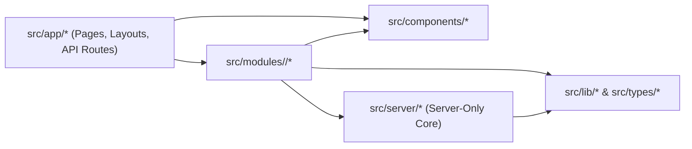

# Module Boundaries & Dependency Direction

## 1. Dependency Direction Rules

All application code follows a strict unidirectional dependency flow to prevent circular dependencies and keep privileged logic isolated from client bundles:

### Hard Rules

1. **No server imports in client layers**: `src/components/*`, `src/hooks/*`, `src/stores/*`, `src/providers/*`, `src/modules/*/components/*`, and `src/modules/*/hooks/*` MUST NOT import `@/server/*`, `@prisma/client`, or any module's `services/` or `repositories/`. Enforced in `eslint.config.mjs` via `no-restricted-imports` and at build time via `"server-only"`.
2. **No cross-module repository access**: Module A must NEVER import Module B's `repositories/*` directly or mutate Module B's database tables directly. Cross-domain workflows call Module B's exported service API or emit a domain job/event.
3. **No business logic in UI or Route Handlers**: `src/app/*` routes and `components/*` delegate validation to Zod schemas and workflows to `actions/` or `services/`.
4. **No barrel-file leakage**: Do not re-export server-only services/repositories alongside client components in the same `index.ts` file. Either export only client-safe public contracts from `index.ts` or import explicit server entrypoints (`@/modules/<domain>/services/...`) from server layers.
5. **No circular imports between modules**: Domain relationships must form a directed acyclic graph (DAG). Shared primitives belong in `src/types/` or `src/server/`.

## 2. Responsibility Breakdown of All 31 Modules

### Platform & Identity Core

| Module              | Primary Domain Responsibility                                                                         | Scope             |
| :------------------ | :---------------------------------------------------------------------------------------------------- | :---------------- |
| `platform`          | Platform-wide super-admin controls, system settings, feature entitlements, tenant lifecycle oversight | Platform          |
| `subscriptions`     | SaaS plans, school billing cycles, plan limits, invoicing, and subscription webhooks                  | Platform / Tenant |
| `schools`           | School provisioning, profile, branding, academic configuration, and tenant settings                   | Platform / Tenant |
| `authentication`    | Login, logout, password reset, MFA, email verification, and session lifecycle                         | Global / Tenant   |
| `users`             | User identity profiles, account status, and multi-school memberships                                  | Global / Tenant   |
| `roles-permissions` | Role definitions, permission catalogs, and school-scoped role assignments                             | Platform / Tenant |

### Academic Core

| Module           | Primary Domain Responsibility                                                                | Scope  |
| :--------------- | :------------------------------------------------------------------------------------------- | :----- |
| `academic-years` | Independent school academic sessions, terms, active session switching, and year-end rollover | Tenant |
| `classes`        | Grade/class levels and academic progression structure                                        | Tenant |
| `sections`       | Class sections/divisions, room capacity, and homeroom assignments                            | Tenant |
| `subjects`       | Subject catalog, class-subject curriculum mapping, and teacher allocations                   | Tenant |
| `timetable`      | Period definitions, conflict-aware scheduling (class, teacher, room), and substitutions      | Tenant |

### People & Enrollment

| Module       | Primary Domain Responsibility                                                                         | Scope  |
| :----------- | :---------------------------------------------------------------------------------------------------- | :----- |
| `admissions` | Inquiries, applications, document verification, seat allocation, and conversion to student enrollment | Tenant |
| `students`   | Student master records, enrollments per academic session, roll numbers, transfers, and promotions     | Tenant |
| `guardians`  | Parent/guardian profiles, emergency contacts, custody/billing flags, and student-guardian links       | Tenant |
| `teachers`   | Teacher academic profiles, subject qualifications, and class/section assignments                      | Tenant |
| `staff`      | Non-teaching and administrative staff directory and department links                                  | Tenant |

### Daily School Operations

| Module         | Primary Domain Responsibility                                                                    | Scope  |
| :------------- | :----------------------------------------------------------------------------------------------- | :----- |
| `attendance`   | Daily/period student attendance, staff attendance, late/leave statuses, and audited corrections  | Tenant |
| `examinations` | Exam schedules, assessment plans, grading scales, weightages, and marks entry windows            | Tenant |
| `results`      | Marks aggregation, grade calculation, moderation, report card generation, and result publication | Tenant |

### Finance & Billing

| Module     | Primary Domain Responsibility                                                                      | Scope  |
| :--------- | :------------------------------------------------------------------------------------------------- | :----- |
| `fees`     | Fee heads, class/term fee structures, discounts/concessions, fines, and student fee assignments    | Tenant |
| `invoices` | Student fee invoices, line items, due dates, credit notes, and immutable ledger state              | Tenant |
| `payments` | Online/offline fee collections, gateway webhooks, idempotent receipts, reconciliation, and refunds | Tenant |

### Optional Operational Modules

| Module            | Primary Domain Responsibility                                                              | Scope  |
| :---------------- | :----------------------------------------------------------------------------------------- | :----- |
| `transport`       | Routes, stops, vehicles, driver assignments, and student transport subscriptions           | Tenant |
| `library`         | Book catalog, copies, member borrowing, issue/return lifecycle, and overdue fines          | Tenant |
| `hostel`          | Hostels/dormitories, rooms, bed allocations, and warden oversight                          | Tenant |
| `human-resources` | Leave management, contracts, appraisals, and HR document workflows                         | Tenant |
| `payroll`         | Salary structures, monthly payroll runs, deductions, payslips, and accounting audit trails | Tenant |

### Engagement & Intelligence

| Module          | Primary Domain Responsibility                                                                   | Scope             |
| :-------------- | :---------------------------------------------------------------------------------------------- | :---------------- |
| `notifications` | Multi-channel delivery orchestration (in-app, email, SMS, push), templates, and delivery status | Tenant / Platform |
| `communication` | Announcements, circulars, direct school-parent messaging, and event calendars                   | Tenant            |
| `reports`       | Operational exports (CSV/PDF), compliance summaries, and asynchronous large report generation   | Tenant            |
| `analytics`     | Aggregated operational dashboards, enrollment/attendance/collection KPIs, and read models       | Tenant / Platform |

## 3. Internal Layering Inside Every Module

See [module-template.md](../modules/module-template.md) for the exact internal subfolder standard (`components/`, `hooks/`, `services/`, `repositories/`, `schemas/`, `types/`, `constants/`, `utils/`, `actions/`, `index.ts`).
