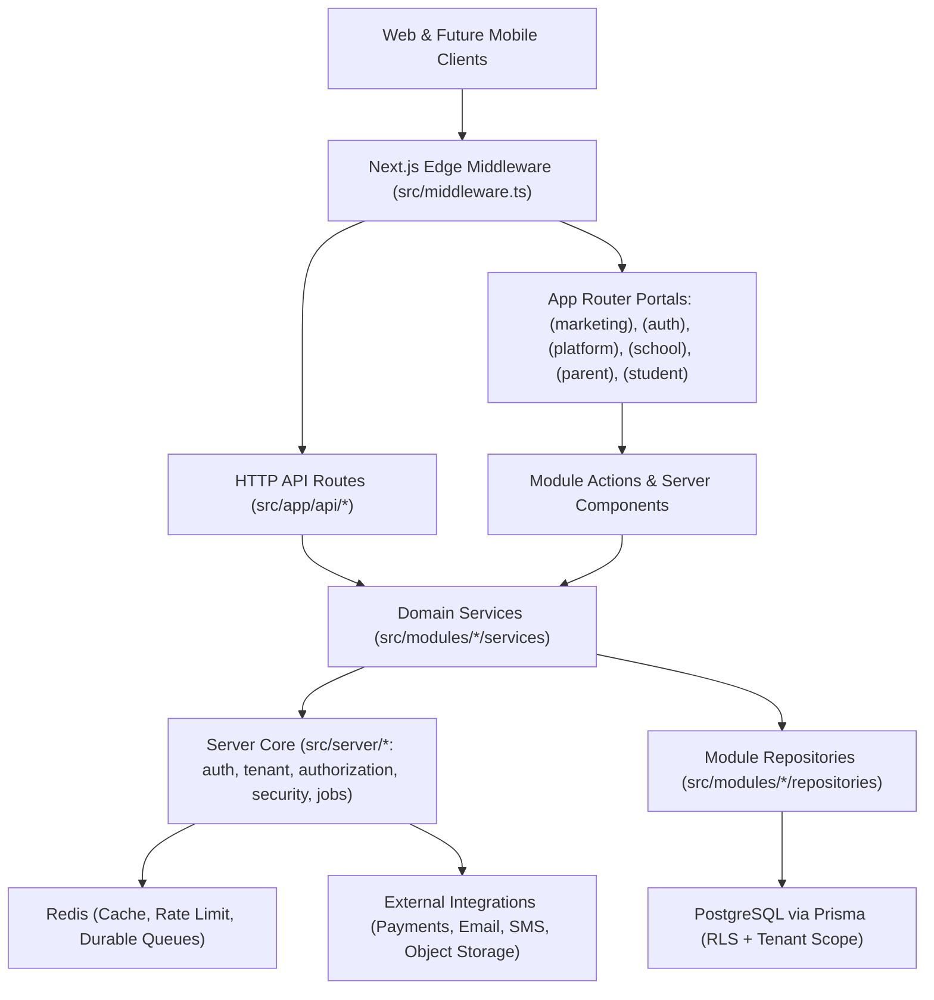

# System Architecture

## 1. Architectural Style

This repository implements the structural foundation for a **Multi-Tenant School Management SaaS** using a **Modular Monolith** built on the Next.js App Router, TypeScript (strict mode), PostgreSQL (Prisma), and Redis.

A modular monolith was chosen over microservices to keep operational complexity low, preserve ACID transactional guarantees across tightly coupled school workflows (such as admissions, fee invoicing, payments, and attendance), and maintain strict compile-time module boundaries inside a single deployable Next.js codebase.

## 2. Current Implementation Scope

This repository currently contains the **foundation layer only**:

- Root and workspace configuration (`package.json`, `tsconfig.json`, `next.config.ts`, `eslint.config.mjs`, `postcss.config.mjs`, `components.json`, `vitest.config.ts`, `playwright.config.ts`)
- Container and CI definitions (`Dockerfile`, `docker-compose.yml`, `.github/workflows/ci.yml`)
- Prisma datasource/generator foundation (`prisma/schema.prisma`, `prisma/seed.ts`) with no domain tables yet
- Next.js App Router root shell (`src/app/layout.tsx`, `loading.tsx`, `error.tsx`, `not-found.tsx`, `page.tsx`, `globals.css`), Edge request boundary (`src/middleware.ts`), and liveness probe (`src/app/api/health/route.ts`)
- Shared utilities and server isolation guards (`src/lib/utils/cn.ts`, `src/lib/configuration/env.ts`, `src/server/server-only.ts`)
- Directory skeletons for 6 portal route groups, 31 domain modules (`src/modules/*`), 9 server infrastructure layers (`src/server/*`), shared UI layers (`src/components/*`), test suites (`tests/*`), and operational scripts (`scripts/*`)

Business modules, database tables, authentication flows, queues, and UI portals are intentionally not implemented yet.

## 3. High-Level System Context

## 4. Portal Route Groups

The App Router separates user surfaces into explicit route groups under `src/app/`:

| Route Group   | Intended Actors                                         | Trust & Tenant Scope                                              |
| :------------ | :------------------------------------------------------ | :---------------------------------------------------------------- |
| `(marketing)` | Public visitors                                         | Public, non-tenant, static/ISR friendly                           |
| `(auth)`      | Unauthenticated / onboarding users                      | Public entrypoints with rate limiting and CSRF/session protection |
| `(platform)`  | Platform Super Admins                                   | Global platform scope; explicit audited access controls           |
| `(school)`    | School Admins, Principals, Teachers, Accountants, Staff | Tenant-scoped (`schoolId` resolved from verified membership)      |
| `(parent)`    | Guardians / Parents                                     | Tenant-scoped + guardian-to-student relationship checks           |
| `(student)`   | Students                                                | Tenant-scoped + self-record access checks                         |
| `api`         | Webhooks, health checks, future mobile clients          | Versioned HTTP contracts; currently hosts `/api/health` only      |

## 5. Runtime Boundaries (Edge vs. Node.js)

- **Edge Runtime (`src/middleware.ts`)**: Used strictly for lightweight request correlation (`x-request-id`) and future coarse route gating. ESLint explicitly blocks importing `@prisma/client` or `@/server/database/*` into `src/middleware.ts`.
- **Node.js Runtime (`src/server/*`, `src/modules/*/services`, `src/modules/*/repositories`, `src/app/api/*`)**: Handles all database access, PostgreSQL tenant-context transactions, authentication verification, authorization checks, cryptographic webhooks, and background job producers.
- **Client Runtime (`"use client"` components, `src/hooks/*`, `src/stores/*`, `src/providers/*`)**: Strictly presentation and client interaction state. Protected from accidental server imports by both `"server-only"` (`src/server/server-only.ts`, `src/lib/configuration/env.ts`) and ESLint `no-restricted-imports` rules.

## 6. Architecture Decision Record (ADR-001: Modular Monolith)

- **Decision**: Adopt a single Next.js modular monolith with 31 domain folders under `src/modules/` and shared privileged infrastructure under `src/server/`.
- **Alternatives Considered**:
  1. Separate Express/NestJS backend service + Next.js frontend: Adds deployment, type-sharing, auth-forwarding, and local-dev overhead before team scale requires it.
  2. Domain-based microservices: Introduces distributed transactions across financial/academic workflows and high operational overhead.
- **Consequences**:
  - Single CI/CD pipeline, unified TypeScript types, and transactional integrity via PostgreSQL.
  - Requires disciplined module boundary enforcement (ESLint rules, code review, and no cross-module repository writes).
- **Future Extraction Path**: Because business logic lives in `src/modules/<domain>/services/` and mobile clients consume versioned routes under `src/app/api/`, high-load workers (such as bulk report generation or notifications) can later run as separate Node worker processes sharing the same service modules without rewriting domain logic.
