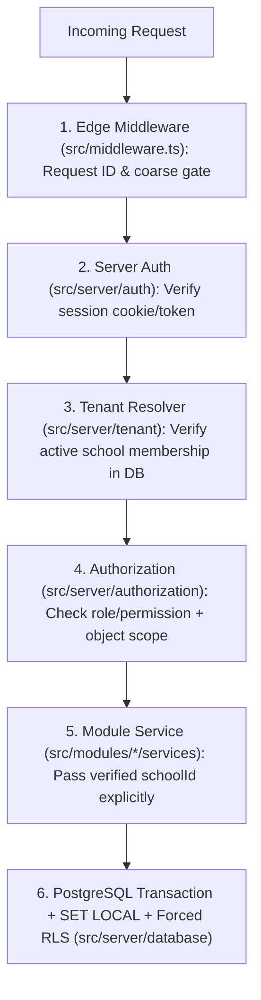

# Multi-Tenant Isolation Architecture

## 1. Threat Model

The platform hosts multiple independent schools on shared application and database infrastructure. Every security control assumes a malicious or compromised tenant user can tamper with URLs, query parameters, request bodies, headers, cookies, or client-side state to attempt cross-school reads, writes, exports, or side-channel inference.

## 2. Defense-in-Depth Layers

### Currently Implemented Guardrails in This Foundation

- **Server/Client Isolation**: `src/server/server-only.ts`, `src/lib/configuration/env.ts` (`import "server-only"`), and `eslint.config.mjs` `no-restricted-imports` prevent server/database logic from leaking into client bundles or Edge middleware.
- **Database Role Separation**: `.env.example` and `prisma/schema.prisma` separate `DATABASE_URL` (application runtime role) from `DIRECT_URL` (DDL migration role) so runtime connections can be constrained with `NOBYPASSRLS`.
- **Dedicated Server Directories**: `src/server/tenant/`, `src/server/auth/`, `src/server/authorization/`, `src/server/database/`, and `src/server/security/` establish clear ownership for upcoming enforcement code.
- **Security Test Suite Slot**: `tests/security/` is wired into `vitest.config.ts` (`npm run test:security`).

### Mandatory Controls for Implementation

1. **Never Trust Client-Supplied Tenant IDs**: Resolve `userId` from a verified server-side session and resolve `schoolId` from trusted server-side membership records (`school_memberships`). Any `schoolId` passed in URLs or payloads must be validated against the user's verified memberships.
2. **Explicit `schoolId` Propagation**: Every tenant-owned repository method must accept a typed `TenantContext` (`{ schoolId, userId, role }`) rather than querying unscoped IDs.
3. **Transaction-Local PostgreSQL RLS**:
   - Execute tenant-scoped Prisma operations inside a wrapper in `src/server/database/` that runs `SET LOCAL app.current_school_id = $1` inside a transaction.
   - Never use session-level `SET` on pooled connections, which can leak tenant context across subsequent requests.
   - Verify the runtime DB role does NOT have `BYPASSRLS` or `SUPERUSER`.
4. **Composite Foreign Keys**: Tenant-owned relational links must enforce matching `school_id` at the PostgreSQL constraint layer.
5. **Cross-Channel Isolation**:
   - **Redis Cache**: Prefix every tenant-scoped cache key with `tenant:{schoolId}:...` and enforce version/tag invalidation per school.
   - **Background Jobs (`src/server/jobs/`)**: Every enqueued job payload must include `schoolId` and `actorUserId`, and workers must re-establish tenant context before reading or writing data.
   - **Object Storage & Exports**: Prefix object keys with `schools/{schoolId}/...` and generate short-lived signed URLs only after server-side permission checks.
   - **Next.js Caching**: Never cache tenant-owned responses in shared/public caches without tenant-scoped cache keys or `no-store`.
6. **Platform Super-Admin Access**: Platform-level overrides (e.g., support impersonation or platform billing) must be explicit, time-bounded, audited in immutable audit logs, and completely unreachable from tenant routes.

## 3. Required Verification Tests (`tests/security/`)

Before any tenant-owned module is released, automated security tests must spin up **School A** and **School B** and prove School A cannot read, update, delete, export, or infer School B's records across direct ID lookups, list filters, batch actions, webhooks, exports, and background jobs.
